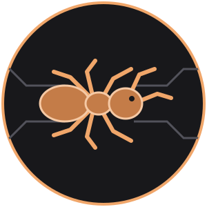
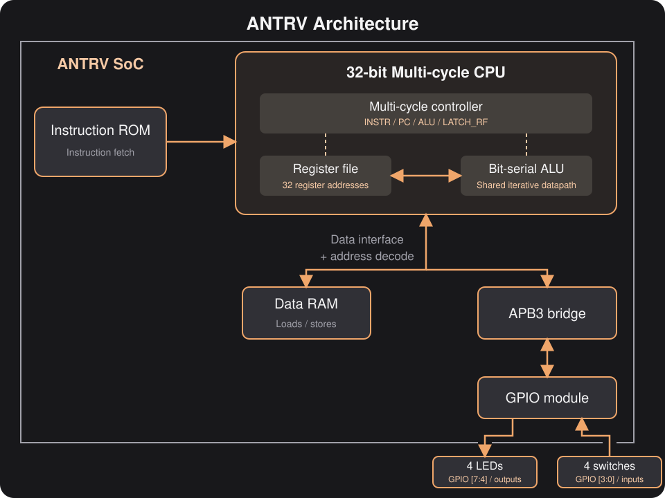

# ANTRV



**A compact, multi-cycle 32-bit RISC-V CPU and GPIO SoC written in SystemVerilog for FPGA implementations.**

ANTRV trades instruction throughput for a small datapath: an iterative, bit-serial ALU executes instructions under a multi-cycle controller. The project includes an APB3 GPIO peripheral, an FPGA wrapper for the Nandland Go Board, and a cocotb verification environment.

## Contents

- [CPU architecture](#cpu-architecture)
- [RISC-V features](#risc-v-features)
- [GPIO peripheral](#gpio-peripheral)
- [iCE40 FPGA resources](#ice40-fpga-resources)
- [Prerequisites](#prerequisites)
- [Running synthesis](#running-synthesis)
- [Running simulation](#running-simulation)
- [Repository layout](#repository-layout)

## CPU architecture

The [CPU](rtl/antrv/antrv_cpu.sv) is a single-hart, non-pipelined, multi-cycle design with a 32-bit datapath.



### Datapath and control

- **Bit-serial ALU:** arithmetic and logical operations process one bit per cycle; shifts iterate according to the shift amount. Operations therefore take multiple clock cycles rather than completing in one cycle.
- **Shared ALU:** the same datapath computes instruction results, effective memory addresses, branch conditions, and next-PC values.
- **Multi-cycle controller:** `INSTR`, `PC`, `ALU`, and `LATCH_RF` states coordinate instruction fetch, operand reads, execution, and register updates. State ordering depends on the instruction.
- **Register file:** 32 register addresses, 32-bit values, a single synchronous read port, and a write port. Writes to register address zero are disabled.
- **Separate instruction and data paths:** instruction fetch uses ROM; loads and stores use RAM or the GPIO peripheral.
- **Memory handshake:** a request/ready interface lets peripheral accesses wait for the APB3 transaction to complete.
- **Reset PC:** execution starts at `0x80000000`.
- **No cache, branch predictor, or MMU.**

The [SoC top](rtl/antrv/antrv_top.sv) uses these software address regions:

| Region | Base address | Address-region size |
|---|---|---|
| Instruction ROM | `0x80000000` | 256 KiB |
| Data RAM | `0x80040000` | 128 KiB |
| GPIO registers | `0x80060000` | 16-byte decoded window |

These describe the default software layout, not memory capacity on the FPGA. The [FPGA wrapper](rtl/antrv_fpga/antrv_fpga_top.sv) reduces both memory address widths to fit the HX1K; only 256 bytes of each memory are addressable through the current word-address wiring. Programs used for FPGA builds must fit that reduced configuration.

## RISC-V features

ANTRV implements the main **RV32I integer instruction datapath**, with 32-bit instructions and little-endian data accesses.

| Category | Instructions |
|---|---|
| Upper immediates | `LUI`, `AUIPC` |
| Integer arithmetic | `ADD`, `ADDI`, `SUB` |
| Comparisons | `SLT`, `SLTI`, `SLTU`, `SLTIU` |
| Bitwise operations | `AND`, `ANDI`, `OR`, `ORI`, `XOR`, `XORI` |
| Shifts | `SLL`, `SLLI`, `SRL`, `SRLI`, `SRA`, `SRAI` |
| Conditional branches | `BEQ`, `BNE`, `BLT`, `BGE`, `BLTU`, `BGEU` |
| Jumps | `JAL`, `JALR` |
| Loads | `LB`, `LBU`, `LH`, `LHU`, `LW` |
| Stores | `SB`, `SH`, `SW`, with byte write masks |

### Scope and limitations

- `FENCE` has no dedicated ordering mechanism; the core is sequential and has no cache.
- Privileged execution, CSR instructions, interrupts, and architectural trap handling are not implemented. `ECALL` and `EBREAK` do not enter an architectural trap handler.
- Misaligned accesses are not supported as an architectural feature; use naturally aligned accesses.
- The `M`, `A`, `C`, floating-point, and vector extensions are not implemented.
- The verification configuration targets RV32I architectural tests, but this is **not a claim of full RV32I or privileged-architecture certification**. The architecture-test configuration is a test/reference-model description, not proof that every listed capability exists in RTL.

## GPIO peripheral

The [GPIO module](rtl/gpio/gpio_top.sv) provides **8 bidirectional pins** through an APB3 register interface. Its register block is generated from [SystemRDL](hal/gpio.rdl) with PeakRDL.

Generate the GPIO register documentation with PeakRDL:

```bash
cd hal
make html
```

This runs `peakrdl html gpio.rdl -o build/html/`. Open `hal/build/html/index.html` in a browser to view the register map and field descriptions.

## iCE40 FPGA resources

The existing local place-and-route report for `antrv_fpga_top`, built with the GPIO firmware, reports:

**Device:** Lattice iCE40 HX1K, VQ100 package  
**Clock constraint:** 25 MHz

| Resource | Used | Available | Utilization |
|---|---:|---:|---:|
| Logic cells (`ICESTORM_LC`) | 1,000 | 1,280 | 78.1% |
| Block RAMs (`ICESTORM_RAM`) | 6 | 16 | 37.5% |
| I/O cells (`SB_IO`) | 44 | 72 | 61.1% |
| Global buffers (`SB_GB`) | 2 | 8 | 25.0% |

The final timing report gives approximately **62.34 MHz**, passing the 25 MHz constraint. This is a place-and-route timing estimate, not measured board performance or instruction throughput.

These numbers cover the **entire FPGA top**, including CPU, memories, GPIO, and board I/O, not just the CPU. The wrapper declares 44 board ports, including ports not used by the GPIO demo. Utilization depends on the firmware image, parameters, tool versions, and placement.

After a build, consult:

- `synthesis/build/synth/antrv_fpga_top.synth.stats`
- `synthesis/build/pnr/antrv_fpga_top.pnr.stats`
- `synthesis/build/pnr/antrv_fpga_top.pnr.log`

## Prerequisites

Run the commands below from the repository root.

### Tools

- GNU Make and Python 3.
- A RISC-V bare-metal GCC toolchain exposing `riscv-none-elf-gcc`.
- **Synthesis:** Yosys with the `read_slang` frontend, `nextpnr-ice40` with support for the Makefile's `--sdc`/`--sdf` options, and IceStorm's `icepack`.
- **Simulation:** Verilator, a C++ compiler, cocotb, AVL (`avl-core`), Capstone, pyelftools, and colorama.
- **Register generation:** PeakRDL and its regblock exporter.
- **Architectural tests:** `sail_riscv_sim` and the additional toolchain described in the [riscv-arch-test setup guide](simulation/riscv-arch-test/README.md).

The current simulation environment uses cocotb 2.x APIs.

```bash
python3 -m venv .venv
source .venv/bin/activate
python -m pip install cocotb avl-core capstone pyelftools colorama peakrdl
```

Initialize the architecture-test submodule if needed:

```bash
git submodule update --init --recursive
```

The configured submodule URL uses SSH, so GitHub SSH access is required unless you override that URL locally.

## Running synthesis

Activate the Python environment first so `peakrdl` is on `PATH`.

### Build firmware and an FPGA bitstream

```bash
cd synthesis
make all ELF=../code/build/gpio_test.elf
```

This generates the GPIO register block, compiles the GPIO firmware, creates memory initialization files, runs synthesis and place-and-route, and packs the bitstream.

### Run individual stages

After building the firmware with `make -C code`:

```bash
cd synthesis
make synth ELF=../code/build/gpio_test.elf
make pnr   ELF=../code/build/gpio_test.elf
make bits  ELF=../code/build/gpio_test.elf
```

Use the same `ELF` setting for every stage. Omitting it builds without a firmware initialization image.

The default design is [antrv_fpga.toml](manifest/antrv_fpga.toml). Board pin and clock constraints live in [constraints/](constraints/).

The resulting bitstream is `synthesis/build/bitstream/antrv_fpga_top.bin`. Board programming is separate from the build targets.

## Running simulation

The [cocotb testbench](simulation/antrv_top_test.py) uses an AVL environment with instruction monitoring, a Sail reference model, a scoreboard, and a GPIO agent. The [simulation wrapper](tb/tb_antrv.sv) exposes external GPIO drive controls without changing the synthesizable SoC.

Activate the Python environment first with `source .venv/bin/activate`. Each command block below assumes you start from the repository root.

### GPIO test

```bash
cd simulation
make firmware
make RERUN=1 test-antrv_top_test-test_gpio
```

The test drives the low GPIO nibble and checks monitored values against the firmware's mirrored output. Completion is controlled by the Python test; the GPIO firmware does not need to write `tohost`.

### RV32I architectural tests

First follow the submodule's prerequisite instructions, then generate the ANTRV RV32I ELFs:

```bash
cd simulation/riscv-arch-test
make \
  CONFIG_FILES="$(pwd)/../act4_config/test_config.yaml" \
  EXTENSIONS=I
```

The testbench discovers ELFs under `simulation/riscv-arch-test/work/antrv/elfs/rv32i/I/`. Generate them **before** collecting tests; otherwise the architectural-test list can be empty.

```bash
cd simulation

# Refresh discovery and list available tests.
make regenerate list-tests

# Run one architectural test.
make RERUN=1 test-antrv_top_test-test_elf-elf-I-ori-00

# Run the full discovered regression, including GPIO.
make -j2 RERUN=1 all
```

Architectural tests wait for a firmware `tohost` write and check execution against Sail. The GPIO test disables the instruction scoreboard and uses GPIO observations instead.

### Logs, waveforms, and reports

Results are stored in `simulation/build/test-<name>/`, including `simulation.log`, `results.xml`, and `dump.fst`. The simulator is built once and shared across tests. Completed results are cached; use `RERUN=1` for a fresh run.

```bash
cd simulation
make status
make html
make lint
```

The HTML report is written to `simulation/build/regression.html`. Open FST waveforms with a compatible viewer such as GTKWave.

## Repository layout

```text
antrv/
|-- code/          # Bare-metal firmware and linker script
|-- manifest/      # TOML source manifests and top-level selections
|-- constraints/   # Go Board pin and clock constraints
|-- docs/
|   `-- images/    # README illustrations
|-- hal/           # SystemRDL GPIO registers and generation targets
|-- python/        # Source parsing, ELF conversion, and report utilities
|-- rtl/           # CPU, SoC, APB3 bridge, GPIO, and FPGA wrapper
|-- simulation/    # cocotb tests and architectural-test integration
|   `-- tb/        # AVL components and testbench utilities
|-- synthesis/     # Yosys, nextpnr, and bitstream build flow
`-- tb/            # Simulation-only SystemVerilog wrapper
```
